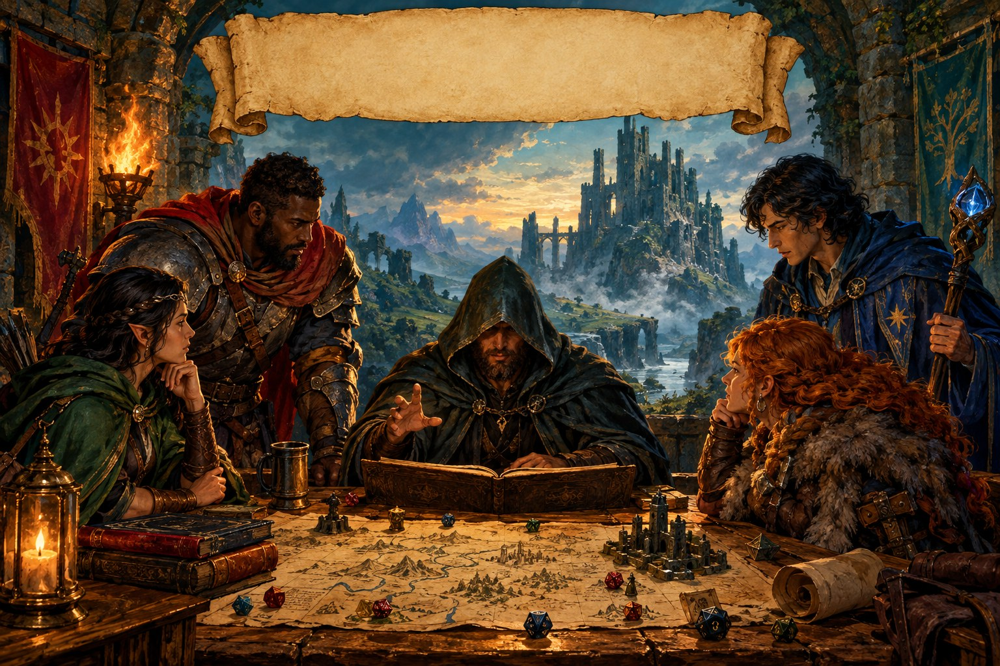
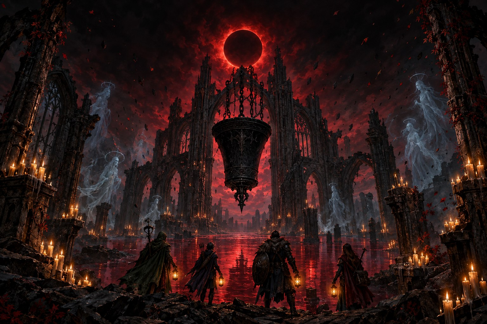
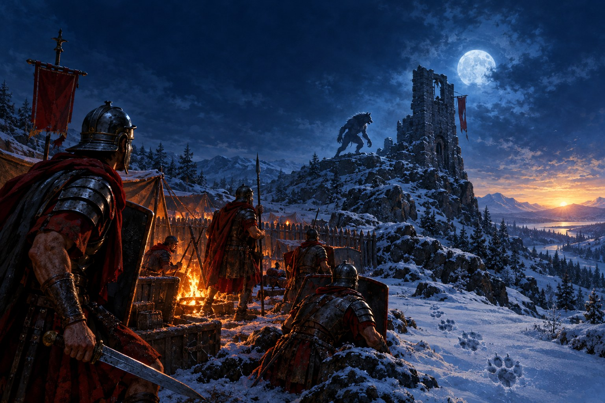

# 🐉 DnD-Agents (`#tabletop-ai`)

> **Unofficial tabletop fantasy roleplay skills for AI agents**
> Play a solo dungeon crawl, run one of several original starter quests, use one agent to portray a party, or coordinate one player agent per character.
> Prompt-based, terminal-friendly, and compatible with **Claude Code**, **Cursor**, **Windsurf**, **Antigravity**, **GitHub Copilot CLI**, and **Hermes**.

[](https://github.com/c4da/dnd-agents/topics)
[](LICENSE)
[](https://aiskillsmarket.com/submit)
[](NOTICE.md)

> **Notice:** This is an unofficial fan-made project. It is not affiliated with
> or endorsed by Wizards of the Coast or any other rights holder. See
> [NOTICE.md](NOTICE.md) before redistributing or monetizing listings.

**Discovery tags:** `#ai-skills` `#agent-skills` `#skill-md` `#tabletop-ai`
`#dnd` `#rpg` `#open-source`

Marketplace indexes can use [`registry.json`](registry.json) for the catalog or
install an individual package from `skills/<skill-name>/`. Each package is
self-contained and includes `SKILL.md`, machine-readable `manifest.json`, and
any referenced content files.

The root [`SKILL.md`](SKILL.md) is the marketplace entrypoint for the complete
collection. Use it when an index requires a repository-level skill file; use
the package-specific files for direct installation.

## 🖼️ Campaign Flyers

<p align="center">
  
</p>

<p align="center">
  
  
</p>

These are original promotional illustrations for this repository.

## 🗺️ Campaign List

| Campaign | Tone | Party | Hook |
|---|---|---:|---|
| [The Lost Shrine of the Sun-Stone](skills/dnd-quest-the-lost-shrine/SKILL.md) | Classic fantasy adventure | 1–3 | Recover a stolen sun relic from a buried shrine |
| [The Hollow Lighthouse](skills/dnd-quest-the-hollow-lighthouse/SKILL.md) | Coastal mystery | 1–3 | Investigate missing crews beneath a silent beacon |
| [The Ember Vault](skills/dnd-quest-the-ember-vault/SKILL.md) | Industrial dungeon survival | 2–4 | Rescue workers before an ember engine overheats |
| [The Sunken Observatory](skills/dnd-quest-the-sunken-observatory/SKILL.md) | Exploration and puzzle | 2–4 | Rebuild a star map in a flooded ruin |
| [The Red Tithe](skills/dnd-quest-the-red-tithe/SKILL.md) | Grim gothic horror | 3–5 | Descend beneath a dying city to break a soul-fed bell |
| [The Wolves of the Ninth Road](skills/dnd-quest-the-wolves-of-the-ninth-road/SKILL.md) | Roman frontier survival horror | 2–4 | Save legionaries and break a werewolf curse before dawn |
| [The Wolf Host at Castra Luna](skills/dnd-quest-the-wolf-host/SKILL.md) | Roman siege survival horror | 3–5 | Defend a rebuilding cohort from a much larger supernatural pack |

The last three campaigns are the darkest. All preserve a path to mercy; **The
Wolves of the Ninth Road** and **The Wolf Host at Castra Luna** are designed to
end on hope.

---

## ❓ Why Does This Exist?

Every tabletop RPG player knows the heartbreak: the campaign is planned, your
character sheet is polished, your dice are ready... and then three people
cancel at 6:30 PM.

DnD-Agents turns a compatible AI agent into a lightweight, in-chat tabletop
roleplay partner. It is intentionally prompt-only: there is no executable
runtime, no external tool access, no file writing, and no network dependency.

---

## 📦 What's Inside the Box?

```text
dnd-agents/
├── SKILL.md                        # Marketplace entrypoint and campaign router
├── assets/                         # README campaign flyers
├── skills/
│   ├── classic-dnd-dungeon-master    # Prompt-based fantasy DM with ASCII maps and d20-style checks
│   ├── dnd-party-of-agents           # Single-agent party or distributed player-agent protocol
│   ├── dnd-quest-the-lost-shrine     # Starter Adventure Module: "The Lost Shrine of the Sun-Stone"
│   ├── dnd-quest-the-hollow-lighthouse # Coastal mystery with a rising-tide clock
│   ├── dnd-quest-the-ember-vault     # Underground rescue with a rising-heat clock
│   ├── dnd-quest-the-sunken-observatory # Flooded ruin with a star-map puzzle
│   ├── dnd-quest-the-red-tithe        # Dark-gothic, graphic-fantasy campaign
│   ├── dnd-quest-the-wolves-of-the-ninth-road # Roman frontier werewolf survival horror
│   └── dnd-quest-the-wolf-host        # Sequel: Roman siege against a larger wolf host
```

### 1. 🎲 `classic-dnd-dungeon-master`
The complete roleplay prompt:
- **In-chat Session Banners**: Starts a campaign header and updates it when a quest is activated.
- **Four Cinematic Origins**: Choose from atmospheric fantasy prologues, including the Ash-Fall of Elmridge.
- **Roguelike ASCII tactical maps** for every chamber, corridor, burning street, and cavern.
- **Lightweight d20 checks and saving throws** (Dexterity vs. dragon breath, Constitution vs. poison).
- **Turn-based initiative combat** tracking HP, Armor Class, and spell slots.
- **Wandering encounter tables** with classic fantasy creatures.

### 2. 🛡️ `dnd-party-of-agents`
An opinionated four-character party with both single-agent and distributed modes:
- **Single-agent mode**: One compatible agent portrays the Paladin, Barbarian, Rogue, and Wizard.
- **Distributed mode**: A Dungeon Master (DM) assigns one player agent to each character, resolves dice, and owns the canonical party state.
- **Sir Valerius (Paladin)**: Plate armor, holy longsword. Devout, honorable, protects the party with *Divine Smite* and *Lay on Hands*.
- **Thokk Ironbreaker (Barbarian)**: Greataxe, unarmored defense. Kicks down doors, rages, screams war cries, and hates complicated plans.
- **Lyra Nightshade (Rogue)**: Dual daggers, shortbow, thieves' tools. Checks for tripwires, picks rusted iron locks, and strikes with *Sneak Attack*.
- **Ignis Shadowweaver (Wizard)**: Starry robes, arcane focus, spellbook. Casts *Detect Magic*, *Fireball*, *Shield*, and complains when his robes get muddy.

The distributed assignment and turn contract are documented in
[`multi-agent-protocol.md`](skills/dnd-party-of-agents/references/multi-agent-protocol.md).

### 3. 🗝️ `dnd-quest-the-lost-shrine` (Modular Adventure Quest)
A turnkey starter quest (*The Lost Shrine of the Sun-Stone*) designed to test and showcase all core mechanics:
- **Act I**: Wilderness tracking, Passive Perception vs. Goblin Stealth, Ranged Ambush.
- **Act II**: Poison dart pressure plates, Thieves' Tools disarm check, the ancient Sun-Riddle.
- **Act III**: Tactical boss battle against *Kragthor the Bugbear Chief* and Skeleton Guardians (Bludgeoning vulnerability).
- **Act IV**: Relic recovery, potion looting, and leveling up to Level 2.

### Additional quest modules

- **`dnd-quest-the-hollow-lighthouse`**: Investigate missing crews, navigate
  flooded tunnels, and redeem or defeat a bound lighthouse keeper.
- **`dnd-quest-the-ember-vault`**: Rescue trapped stonewrights, manage a
  rising heat clock, and stabilize or seal a dangerous ember engine.
- **`dnd-quest-the-sunken-observatory`**: Climb Compass Ridge, solve a
  constellation map, and decide the fate of a lonely astral caretaker.
- **`dnd-quest-the-red-tithe`**: Cross a dying city, descend through an
  ossuary of stolen names, and confront the bell beneath the cathedral.
- **`dnd-quest-the-wolves-of-the-ninth-road`**: Escort Roman legionaries
  through a supernatural winter, face werewolves, and break the curse before
  dawn.
- **`dnd-quest-the-wolf-host`**: Continue the story at Castra Luna as the
  restored cohort faces a much larger pack and the force driving it.

> **Content note:** `dnd-quest-the-red-tithe` is intentionally grim and
> includes graphic fantasy violence, ritual horror, plague imagery, and bleak
> choices. The skill includes guidance for softening or skipping descriptions.
> `dnd-quest-the-wolves-of-the-ninth-road` contains survival horror and
> frightening transformations, but is written toward a hopeful ending.

---

## ⚡ Install

### SkillsMarket

Browse or submit the skills at [SkillsMarket](https://aiskillsmarket.com/submit).
The marketplace requires an account to submit a skill.

### Manual installation

```bash
git clone https://github.com/c4da/dnd-agents.git
cp -r dnd-agents/skills/* ~/.gemini/antigravity/skills/
```

On Windows PowerShell:

```powershell
git clone https://github.com/c4da/dnd-agents.git
Copy-Item -Recurse .\dnd-agents\skills\* "$HOME\.gemini\antigravity\skills\"
```

For another compatible agent, install the selected skill according to that
agent's `SKILL.md` directory convention or paste the file into its supported
system-prompt configuration.

---

## 🎮 How to Play

### Mode A: You are the Dungeon Master (Run an Adventure for the AI Party)
Describe the environment, monsters, and traps. The AI party will talk in character, propose tactics, roll d20 dice, and react to your rulings:

```text
DM (You): You stand before the subterranean crypt of the Lich Lord. 
The double oak doors are sealed with three glowing purple warding runes.

Valerius (Paladin):
*Lifts his glowing shield, whispering a prayer to Helm.*
"Necromantic sorcery! Ignis, can you identify the nature of these unholy wards?"

Ignis (Wizard):
*Adjusts spectacles, pulling out material components.*
"Let me cast Detect Magic as a ritual! *Rolls Arcana check: 18!* 
Ah! These are Abjuration runes tied to an alarm spell. If forced open, it triggers 
a Cloudkill within the hallway!"

Thokk (Barbarian):
*Spits on his hands and hefts his greataxe.*
"THOKK NOT AFRAID OF PURPLE CLOUD! THOKK SMASH WOODEN DOOR!"

Lyra (Rogue):
*Grabs Thokk's shoulder, pulling him back.*
"Back off, you big ape! Let me use my thieves' tools to scratch out the anchor rune first! 
DM, I roll Sleight of Hand with my thieves' tools to disarm the ward!"
```

---

### Mode B: Solo Dungeon Crawl (The AI is your Dungeon Master)
The DM generates the world, renders ASCII dungeon maps, and calls for your rolls:

```text
User: I carefully inspect the stone sarcophagus for traps before opening it.

DM:
*Behind the cardboard DM screen, polyhedral dice clatter against felt.*
"You step lightly around the stone perimeter, running your gauntlets along the carved elven runes."
Roll an Intelligence (Investigation) check, DC 13!

User: /roll

DM:
         / \
        / 15\    [ D20 ROLL: 15 + 0 (INT Mod) = 15 ]
       /_____\   >> SUCCESS! (DC 13 Passed)

"Your sharp eye catches a hairline groove along the rim of the lid. A thin silver wire 
leads down into a lead pipe filled with sleep gas!
With a steady hand and your dagger, you snip the tripwire cleanly. The trap is disarmed!
Inside lies a skeletal knight clutching a +1 Silver Shortsword and a velvet pouch with 45 ancient gold pieces!"
```

---

### Mode C: Distributed Player Agents

Use one Dungeon Master (DM) and one compatible player agent per character. The
DM creates an assignment manifest, sends each agent its character profile and
permitted knowledge, then resolves each `PLAYER_ACTION` into a canonical
`TURN_RESULT`.

```text
DM / COORDINATOR: You control the scene, NPCs, monsters, rolls, and shared state.
PLAYER AGENT: You control Lyra only. Be cautious, pragmatic, and dryly funny.
PLAYER AGENT: Submit one action per turn. Do not invent dice results or speak
for another character.
```

Custom profiles can override temperament, goals, fears, bonds, voice, and
tactical bias without changing a character's statistics or abilities. The
complete protocol covers timeouts, hidden information, conflicting actions,
and state handoff:
[`skills/dnd-party-of-agents/references/multi-agent-protocol.md`](skills/dnd-party-of-agents/references/multi-agent-protocol.md).

---

### Session Resume

You can leave and resume a campaign whenever you want. Most compatible agent
CLIs provide a basic `/resume` command or an equivalent session-history
feature. Before leaving, ask the Dungeon Master to print a compact checkpoint
with the session ID, scene, party state, initiative, active clocks, inventory,
open quests, and player assignments. The skill itself is prompt-only and does
not persist state; resume behavior depends on the host CLI retaining the
conversation.

---

## 🗺️ Roguelike ASCII Visuals

```text
       # # # # # # # # # # # # # # # # # # # #
       # . . . . . . . [ALTAR/$] . . . . . . #   LEGEND:
       # . . . . . . . . . K . . . . . . . . #   K = Kragthor (Bugbear Boss)
       # . . P . . . . . . . . . . . . P . . #   P = Stone Pillar (Half-Cover)
       # . . Z . . . . . . . . . . . . Z . . #   Z = Skeleton Guardians (Vulnerable to Bludgeoning)
       # . . . . . . . . . . . . . . . . . . #   $ = Sun-Stone on Altar
       # . . . . . . . . @ . . . . . . . . . #   @ = The Party
       # # # # # # # # # + # # # # # # # # # #
```

---

## ✍️ How to Write Custom Quest Modules

Want to write your own adventure module? Simply create a new folder under `skills/dnd-quest-<your-adventure-name>` following this template:
1. `SKILL.md`: Frontmatter, synopsis, and 3–4 Acts detailing scenes, traps, and boss encounters.
2. `references/encounter-maps.md`: ASCII maps with coordinate legends.
3. `references/monster-statblocks.md`: Fantasy stat blocks (AC, HP, Actions, Weaknesses).
4. Run `python tools/validate_catalog.py` to update the catalog hashes, then
   run `python tools/validate_catalog.py --check` before publishing.

---

## 🛠️ Verification & Cryptographic Provenance

Every skill and quest module includes a manifest and a reproducible SHA-256
package hash covering `SKILL.md` and its reference files. The generated
manifest is excluded to avoid a self-referential hash:
```bash
python tools/validate_catalog.py
python tools/validate_catalog.py --check
```

The hash proves package integrity after publication; it is not a digital
signature or proof of author identity.

---

## Optional AgentTrace integration

AgentTrace is a separate project. These skills do not require it, but an
AgentTrace gateway can be used by agent workflows that need session telemetry,
policy enforcement, or an audit trail.

## 📄 License
Original project material is released under the [MIT License](LICENSE). See
[NOTICE.md](NOTICE.md) for the fan-made and third-party rights notice.
